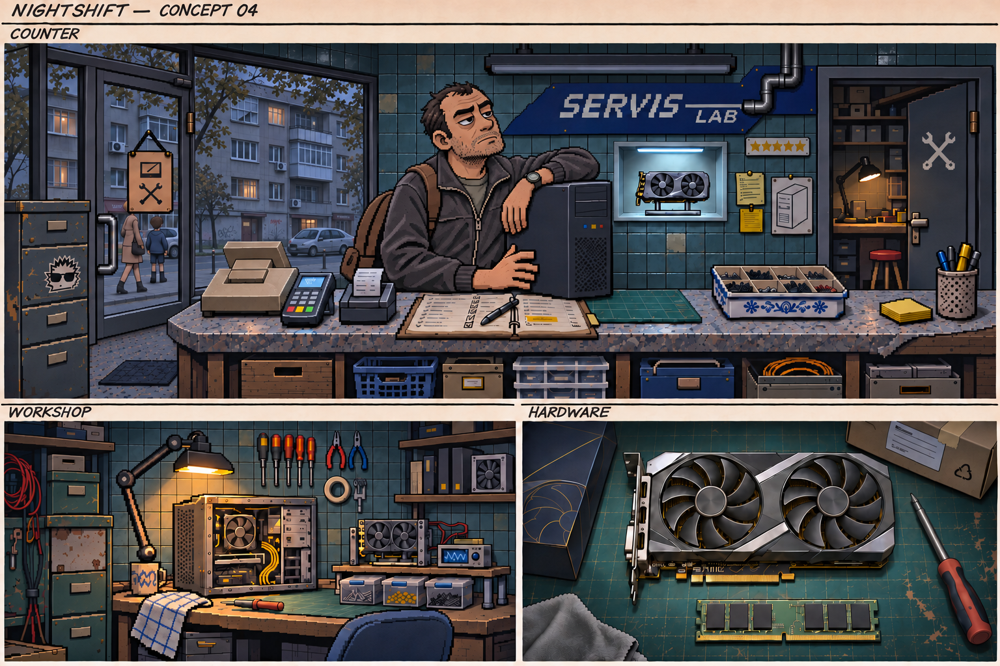
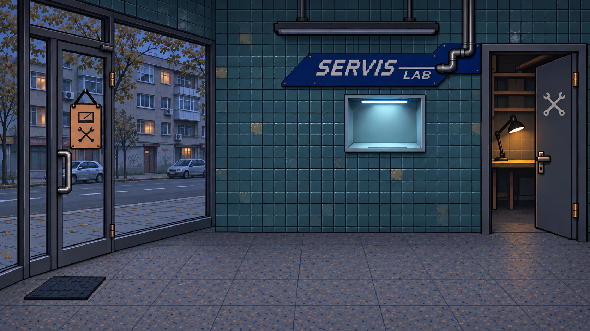

# Nightshift art reference — first counter test

Current art brief, 23 November 2026. Author: Codex (GPT-6; exact deployment model id not exposed by this session), ChatGPT Work.
Read this BEFORE producing or integrating art. It records the user's latest instructions, not a request to implement new gameplay. Asset tasks and acceptance: [FIRST_DAY_ART_CHECKLIST.md](FIRST_DAY_ART_CHECKLIST.md). Existing room loading instructions: [ROOM_ART_GUIDE.md](ROOM_ART_GUIDE.md). Lifecycle/navigation remain authoritative for behaviour.

## 1. Authority and latest references

Priority: latest user instructions here -> current art brief/checklist -> approved look -> individual drafts -> older concept sheets. The user accepted the look provisionally, not every object in the concept image. The latest request requires under-counter grid storage and only the clipboard as initial tabletop dressing. It supersedes decorative cubbies that would obstruct the grid and the populated concept's tabletop prop list.

| Existing image (copied unchanged into this repo) | Use | Limit |
| --- | --- | --- |
| [look-reference.png](../art/references/look-reference.png) | Overall palette, local character, readable dusk, large glazing, precise hardware in close-up | Three-panel concept, not a runtime background; its customer/props are not a fixed starting scene |
| [counter-room-draft.png](../art/references/counter-room-draft.png) | Latest empty room architecture | Entry door, glazing, street and lights are baked together; not yet animation-ready |
| [counter-foreground-draft.png](../art/references/counter-foreground-draft.png) | Empty top, terrazzo/faux-marble and worn wood | Four decorative cubbies are provisional; they must not divide or shrink the 20 x 10 logical grid |
| [clipboard-draft.png](../art/references/clipboard-draft.png) | Plain board, blank paper and steel clip | Scale/perspective need alignment; live text and interaction are not painted in |

The references are under `art/references/`, NOT `art/rooms/` or `art/customers/`; nothing auto-loads them into gameplay. `manifest.json` records exact dimensions, hashes, original names and Library provenance. Counter/clipboard alpha exists (range 0–255). The room draft is 1672 x 941 and clipboard 1086 x 1448, not agreed native sprite dimensions. Existing generated pixel-like artwork is reference, not a certified uniform pixel grid. Do not silently stretch or rename drafts into production assets.

## 2. User instructions to preserve

- Layered 2D first. 3D models rendered into 2D images are a possible later workflow, not the current task.
- Grimy comic character; room/character direction now pixel art. Hardware stays precise illustrated art in close-up for now (hybrid under review), with matching palette/material identity. Room-distance hardware can be simplified. Do not render the same part inconsistently across views.
- Fictional contemporary Balkan / Eastern European setting, with a self-aware postmodern tone. Character comes from layers of renovation, local commercial design, personal choices and functional improvisation. The worn shop versus immaculate hardware contrast is intentional.
- Avoid a grab bag of overused regional tropes: automatic crime/poverty caricatures, flags, tracksuits, alcohol jokes, socialist symbols, ruined-block postcards or generic cyberpunk. Characters are individuals; use grooming, clothes, posture and behaviour, not a supposed single regional face.
- Full-height petrol-blue / blue-grey ceramic tiles, coherent straight grout pattern. Selective chips and wear, not a dirty filter across everything.
- Shady and gloomy, but NOT as dark as the earlier 0.04 concept pass. The latest brighter dusk revision is authority: cool exterior fill, local warm task light, readable faces/objects, shadowy corners. No uniformly bright retail lighting and no crushed blacks.
- Larger street-facing window beside the entrance. Keep the outside mood the user liked: ordinary apartments, enclosed balconies, AC units, modest shopfronts, parked cars and dusk windows. No indoor plants.
- No floating shelves on the COUNTER wall for now. Workshop shelving is a separate matter. Keep the emptied tile wall.
- Initial tabletop: ONLY the clipboard. No till, payment terminal, receipt printer, pen pot, loose screws/dish, sticky notes, ledger, mat, phone or fixed PC painted onto the top. This is an art scope instruction, not permission to delete existing till/phone/report mechanics.
- People, PC cases, loose parts, stored contents, papers/text and inventory must be dynamic layers. No fixed customer/PC in a background; no fixed pedestrians when their movement is later added.
- Respect occlusion: outside people behind glass/sign; customers behind counter front; hands and items on top use appropriate front layers. Never paint tile patterns through objects.
- Under-counter STORAGE GRID is essential. Make room for it visibly, or provide the user-authorized alternative of looking under the counter on hover. Read section 4 before drawing counter furniture.

## 3. Layer and delivery contract

Suggested working production convention, NOT a previously approved pixel specification: one 1280 x 720 logical screen, room/foreground art authored on a 640 x 360 grid and displayed at exactly 2x nearest-neighbour. Use this common draft convention until the user/integrator locks another; do not have each agent pick its own pixel density. UI typography remains legible at 1280 x 720. Hardware inspection may use higher-resolution illustration with deliberate transitions and shared colours. No engine/resolution change in this documentation task.

Separate components, back to front:
1. Exterior matte (behind glass); separate pedestrians later.
2. Room shell: tiled wall, floor, fixed architectural frames and sign.
3. Glass/reflections, door leaf and shutter as separate layers when animated; clean scenery behind removed objects must exist.
4. Customer body behind the counter (main referenced man is NOT automatically Mara or Relu).
5. Counter top/front; separate top/frontal occlusion masks if needed for items and hands.
6. Placed PCs/parts, customer hands when reaching over the top, clipboard and other explicitly authorized dynamic props. No unconditional universal z-order: hands/items change front/back relationship when placed/carried.
7. Runtime paper text, hover/focus feedback, dialogue and storage look-down view.
8. Separate light masks/effects; don't bake incompatible day/night light into sprites.

Mandatory credits/status: update FIRST_DAY_ART_CHECKLIST checkboxes and ART_ASSET_LOG.md with the actual creator, tool/model, date, per-file paths and original/edit history. Creation is separate from integration.

For every delivery provide: stable asset ID, owned files, source resolution, logical dimensions, anchor/pivot, transparent bounds, screen placement guide, intended layer, permitted motion/rotation, states, local lighting assumptions and what remains dynamic. Full-screen layers share a canvas/origin; individual props get transparent margins plus explicit anchors. Export PNG with real alpha, not a checkerboard background; retain editable source if available. No sample ticket text, money, stars, fault labels or item counts in image pixels. No arbitrary coloured inventory cells baked into the art. Use `art/drafts/<task-id>/` for new drafts, not live auto-loaded paths, until integration is authorized. Do not overwrite references or other contributors' assets.

## 4. Under-counter storage: capacity before decoration

### Existing implementation, checked on main 960b847 (0.56.1)

- `scripts/storage/storage_data.gd`: one `counter` unit, **20 columns x 10 rows**, accepting PCs, tools and parts. The earlier user wording was 10 x 20; the shipped orientation is 20 wide x 10 high. Preserve it unless explicitly changed.
- `scripts/rooms/under_counter_view.gd`: separate close-up opened from the counter, grid `Rect2(40,140,600,300)` at 30 pixels/cell. Real item footprints, dragging and R/Q/E rotation already exist.
- Same storage layout/UIDs as stock room, no second inventory, duplicated item or ownership transfer by moving it. Storage UI reads allowed known condition, not hidden actual faults. Keep rollback/save behaviour.
- Hover pull-up/peek is NOT implemented. New layering, art and opening gestures require a bounded UI implementation later; do not claim that the artwork alone adds this.

### Reference video actually inspected

User recording: `Screen Recording 2026-11-12 201004.mp4`, 16.6 s, 2558 x 1598; Library ID `libfile_fe50187dc22c81918c3f5156a4a2dff3`.
[Original recording](https://chatgpt.com/library?file_id=libfile_fe50187dc22c81918c3f5156a4a2dff3&account_id=personal).
Inspected frames at approximately **2 s, 8 s and 14 s**. At 2 s the hint overlay names counter/inventory transfer and rotation; at 8 s a broad uninterrupted spatial grid is visible immediately beneath the worktop, with differently sized objects spanning cells; at 14 s a separate storage-bay/container grid is open over it. These observations establish spatial readability and the under-counter relationship. They do NOT establish an automatic hover gesture. The user independently permits a hover look-under alternative. Borrow the relationship/handling idea, not the game's art, layout, UI copy or assets. The recording is not committed to this public repo.

### Two permitted presentations, recommendation not final selection

A. **Always-visible grid:** provide one continuous projected storage area under the worktop, with usable cell size and adequate contrast. Do not cram 10 rows into a shallow decorative slot or let columns/doors divide the logical grid.

B. **Look-under view (recommended for this first art test):** keep a readable under-counter opening in the room, then reveal a larger downward-looking storage view when hovered (click/keyboard equivalent remains available). Treat it visually as looking under the same counter, not another location or a new capacity upgrade. It uses the SAME 20 x 10 grid and live items.

Working layout proposal for B at 1280 x 720 (not locked coordinates):
- Room under-counter target around `Rect2(200,536,1040,124)`; keep bottom status strip clear and make the target follow the final counter, not arbitrary art pixels.
- Open shell around `Rect2(160,144,960,520)`; continuous interior grid `Rect2(200,192,880,440)` = **44 px/cell**, exactly 20 x 10. Native 640 x 360 counterparts are half these values. Asset shell borders/handles must stay OUTSIDE that grid.
- Deliver separate closed/front silhouette, open/look-down empty interior and rim/foreground mask. Contents, valid/invalid placement, labels and grid lines are engine-drawn, with a clear cell-to-image transform. No baked pile, filled cells or fake 3D content.
- Hover timing/animation are proposed tuning, not an approved mechanic. A hover-open view must stay open while the pointer moves into it, focuses controls or carries an item; no collapse mid-drag. Include click/focus opening, Esc/back handling and source rollback. Existing close-up is the first playable fallback; no automatic pause or night-cost change is selected here.
- Demonstrate EMPTY, representative mixed-size occupied, near-full, blocked drop and rotated-item layouts using real item data. Four wood cubbies in the draft cannot become four inventories or four capacity partitions.

## 5. Integration and scope boundaries

This task creates documentation and copies existing references ONLY. No new art, screenshot assembly, engine code, save contract, hover UI or campaign change. Current room loader still supports a flat background plus hotspots; it does NOT yet implement this layered composition. ROOM_ART_GUIDE's one-image workflow remains the shipped fallback, not the final layered contract.

Keep existing phone/reviews, cash/status, tickets, shutter/end-night, pause, navigation and storage reachable during a staged art swap. Do not remove working functions because their decorative props were omitted. A temporary unobtrusive existing control is preferable to inventing new tabletop furniture; any new permanent presentation is discussed separately. First-day intake/walk-in narrative is not added by art. The separate 0.57.0 gameplay branch adds a customer-first opening before night one; main keeps the previous start until that PR merges. No new art is installed by that feature.

No new clothing stereotypes, new plot, customer identity rewrite, catalogue, fault inference, police system, physical sales rules, upgrades or minigame mechanics. Preserve manual deferral, scheduled checker role and 0.60.0 structural marker. The suggested Claude/Gemini art batches are instructions for the user to assign, not autonomous agents launched/contacted by this task.
